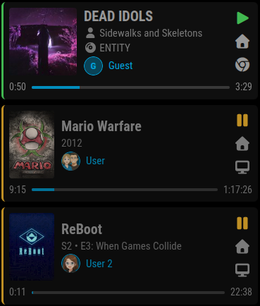

# MMM-JellyfinNowPlaying ![Version][version-shield]

[![GitHub issues][issues-shield]](https://github.com/zanix/MMM-JellyfinNowPlaying/issues)
[![GitHub pull requests][pull-requests-shield]](https://github.com/zanix/MMM-JellyfinNowPlaying/pulls)
[![GitHub forks][forks-shield]](https://github.com/zanix/MMM-JellyfinNowPlaying/network)
[![GitHub stars][stars-shield]](https://github.com/zanix/MMM-JellyfinNowPlaying/stargazers)
[![License][license-shield]](https://github.com/zanix/MMM-JellyfinNowPlaying/blob/main/LICENSE)

[![Build status][build-status-shield]](https://github.com/zanix/MMM-JellyfinNowPlaying/actions/workflows/automated-tests.yaml)
[![Last commit][last-commit-shield]](https://github.com/zanix/MMM-JellyfinNowPlaying/commits/main)
[![Commits][commits-shield]](https://github.com/zanix/MMM-JellyfinNowPlaying/commits/main)

A [MagicMirror²](https://github.com/MagicMirrorOrg/MagicMirror) module that shows what is currently playing on your [Jellyfin][jellyfin-link] server.

## Description

This module connects to your [Jellyfin][jellyfin-link] server and displays the currently playing media, including the user, device, and playback progress. It supports live updates via WebSocket or standard polling, and can be customized to show or hide various elements, filter by media type or user, and style the display.

[Jellyfin][jellyfin-link] is a free and open-source media server software that allows you to organize, manage, and stream your media content.

## AI Disclosure

This project has been assisted by AI tools. The AI was used to help write and edit documentation, generate code snippets, and provide suggestions for improving the codebase. All contributions made by AI have been reviewed and verified by myself to ensure accuracy and quality.

## Table of Contents

- [Screenshots](#screenshots)
- [Features](#features)
- [Requirements](#requirements)
- [Installation](#installation)
- [Update](#update)
- [API Key Generation](#api-key-generation)
- [Configuration](#configuration)
  - [Configuration Example](#configuration-example)
  - [Configuration Validation](#configuration-validation)
- [Translations](#translations)
- [Special Thanks](#special-thanks)
- [Contributing](#contributing)
  - [Code of Conduct](#code-of-conduct)
- [License](#license)
- [Changelog](#changelog)

## Screenshots



## Features

- Displays currently playing media on your Jellyfin server
- Live updates via WebSocket or polling
- Shows a card per-stream with the media image, media info, user, local/remote status, device, and playback progress
- Music shows a wider square album cover with the artist and album on their own lines
- Streams are ordered by playing first, then paused, then stopped
- Pauses updates while the module is hidden or suspended, and refreshes when it returns
- Display options (show/hide elements, filter by media type and/or user)
- Users without an avatar get a circle with their initials
- Support for [translations](#translations)
- Multiple instance support, just add another entry of this module to the MagicMirror `config.js`
- Error handling [validates the configuration](#configuration-validation), handles an unreachable server with progressive backoff (max 60 seconds), and recovers automatically when the server returns. Critical errors are displayed directly in the module, and non-critical errors are logged to the console.

## Requirements

- MagicMirror² 2.26.0 or newer (`node_helper.js` relies on Node.js 18+ and its built-in `fetch`)
- A [Jellyfin][jellyfin-link] server.

> [!NOTE]
> This module is built primarily for Jellyfin 12 and has only been tested on 12. It might work with older versions, but that is not guaranteed. If you are using an older version of Jellyfin, please test and report any issues.

## Installation

Clone `MMM-JellyfinNowPlaying` into the modules folder of your MagicMirror² installation:

```bash
cd ~/MagicMirror/modules
git clone https://github.com/zanix/MMM-JellyfinNowPlaying
```

Then install the dependencies:

```bash
cd MMM-JellyfinNowPlaying
npm ci --omit=dev --ignore-scripts
```

> [!TIP]
> You can use a specific version by checking out a tag or commit after cloning. For example, to use `v1.0.0`:
>
> ```bash
> git checkout v1.0.0
> ```

## Update

Go to the `MMM-JellyfinNowPlaying` folder inside the MagicMirror² `modules` folder and pull the latest version from GitHub:

```bash
cd ~/MagicMirror/modules/MMM-JellyfinNowPlaying
git fetch
git pull
```

Then update the dependencies:

```bash
npm ci --omit=dev --ignore-scripts
```

Restart MagicMirror² after updating.

## API Key Generation

Jellyfin requires an API key for authentication. You can generate an API key by going to the Admin Dashboard -> API Keys (or using this path `web/#/dashboard/keys`). Use an admin API key to see all user sessions.

## Configuration

<!-- prettier-ignore-start -->
<!-- markdownlint-disable MD033 MD060 -->
| Option                  | Default                        | Description |
| ----------------------- | ------------------------------ | ----------- |
| `serverUrl`             | `http://localhost:8096`        | <p>Jellyfin base URL</p><p>**REQUIRED**<br>**Type:** `string`</p> |
| `apiKey`                | –                              | <p>Authentication. Use an admin API key to see all user sessions</p><p>**REQUIRED** (When not using `username` and `password`)<br>**Type:** `string`<br>**Example:** `"eyhJbcG..."`</p><p>**Note:** You can generate a key by going to the Admin Dashboard -> API Keys (or using this path `web/#/dashboard/keys`).</p> |
| `username`              | –                              | <p>The username for your Jellyfin account.</p><p>**REQUIRED** When not using `apiKey`<br>**Type:** `string`</p> |
| `password`              | –                              | <p>The password for your Jellyfin account. May be empty, but a warning is logged when `username` is set.</p><p>Used When not using `apiKey`<br>**Type:** `string`</p> |
| `updateInterval`        | `10`                           | <p>Seconds between updates (used when WebSocket is unavailable)</p><p>**Type:** `integer`<br>**Example:** `5`<br>**Unit:** `seconds`<br>**Range:** `5` to `3600`</p> |
| `useWebSocket`          | `true`                         | <p>Live updates via Jellyfin's `/socket`, falling back to polling</p><p>**Type:** `boolean`<br>**Possible values:** `true`, `false`</p> |
| `stoppedDisplaySeconds` | `10`                           | <p>How long a stopped session stays visible (`0` disables)</p><p>**Type:** `integer`<br>**Example:** `5`<br>**Unit:** `seconds`<br>**Range:** `0` to `3600`</p> |
| `showUserAvatar`         | `true`                        | <p>Shows the user's avatar image</p><p>**Type:** `boolean`<br>**Possible values:** `true`, `false`</p> |
| `showUserName`           | `true`                        | <p>Shows the user's name</p><p>**Type:** `boolean`<br>**Possible values:** `true`, `false`</p> |
| `showDeviceIcon`         | `true`                        | <p>Shows the streaming device icon</p><p>**Type:** `boolean`<br>**Possible values:** `true`, `false`</p> |
| `showDeviceName`         | `false`                       | <p>Shows the streaming device name</p><p>**Type:** `boolean`<br>**Possible values:** `true`, `false`</p> |
| `showStatusIcon`         | `true`                        | <p>Shows the playing status icon</p><p>**Type:** `boolean`<br>**Possible values:** `true`, `false`</p> |
| `showLocationIcon`       | `true`                        | <p>Shows whether the stream is local or remote</p><p>**Type:** `boolean`<br>**Possible values:** `true`, `false`</p> |
| `showProgressBar`        | `true`                        | <p>Shows the progress bar, current time and media length</p><p>**Type:** `boolean`<br>**Possible values:** `true`, `false`</p> |
| `showPoster`             | `true`                        | <p>Shows the media poster</p><p>**Type:** `boolean`<br>**Possible values:** `true`, `false`</p> |
| `showTranscode`          | `true`                        | <p>Shows a badge over the poster when the stream is being transcoded (requires `showPoster`)</p><p>**Type:** `boolean`<br>**Possible values:** `true`, `false`</p> |
| `showMultipleUsers`     | `true`                         | <p>Show all sessions, otherwise only the first</p><p>**Type:** `boolean`<br>**Possible values:** `true`, `false`</p> |
| `playbackLocation`      | `"all"`                        | <p>Show local, remote, or all sessions</p><p>**Type:** `enum`<br>**Example:** `local`<br>**Possible values:** `"all"`, `"local"` or `"remote"`</p> |
| `mediaTypes`            | `[]` (all)                     | <p>Filter by Media types.</p><p>**Type:** `array`<br>**Example:** `[ "movie", "series" ]`<br>**Possible values:** `movie`, `series`, `music`, `other`</p> |
| `mediaTypeFilterMode`   | `"allow"`                      | <p>Set the `mediaType` filter as an allow or block-list</p><p>**Type:** `enum`<br>**Possible values:** `allow`, `block`</p> |
| `users`                 | `[]`                           | <p>Filter by Jellyfin username (case-insensitive)</p><p>**Type:** `array`<br>**Example:** `[ "username1", "dad" ]`<br>**Possible values:** Any Jellyfin username</p> |
| `userFilterMode`        | `"allow"`                      | <p>Set the `users` filter as an allow or block-list</p><p>**Type:** `enum`<br>**Possible values:** `allow`, `block`</p> |
| `userMapping`           | `{}`                           | <p>An object defining a username that maps to a "display" name</p><p>**Type:** `object`<br>**Example:** `{ "jfuser": "Dad", "username2": "Johnny" }`</p> |
| `headerTemplate`        | `{header_text} ({play_count})` | <p>Template for the module header text when there is at least one stream.</p><p>**Type:** `string`<br>**Example:** `Now Playing: {user_count}`</p><p>**Note:** Supports `{header_text}`: Module header text, `{play_count}`: Number of streams displayed, `{user_count}`: Number of users streaming.</p> |
| `headerTemplateZero`    | `{header_text}`                | <p>Template for the module header text when there are no streams</p><p>**Type:** `string`<br>**Example:** `Now Playing: {user_count}`</p><p>**Note:** Supports `{header_text}`: Module header text, `{play_count}`: Number of streams displayed, `{user_count}`: Number of users streaming.</p> |
| `hideWhenIdle`          | `true`                         | <p>Hide module when nothing is playing</p><p>**Type:** `boolean`<br>**Possible values:** `true`, `false`</p> |
| `posterWidth`           | `"3.2em"`                      | <p>Poster width, any CSS length. Music album covers are 1.5× this width</p><p>**Type:** `string`<br>**Example:** `"90px"`, `"6em"`</p> |
| `fontSize`              | `"small"`                      | <p>Base font size of the module. All other sizes (`em`) scale from it, using MagicMirror's size classes</p><p>**Type:** `string`<br>**Possible values:** `"xsmall"`, `"small"`, `"medium"`, `"large"`, `"xlarge"`</p> |
| `titleFontSize`         | `1em`                          | <p>Font size for the stream title. Can be any valid CSS value for `font-size`</p><p>**Type:** `string`</p> |
| `textFontSize`          | `0.75em`                       | <p>Font size for the stream subtitle and other text. Can be any valid CSS value for `font-size`</p><p>**Type:** `string`</p> |
| `accentColor`           | `#00a4dc`                      | <p>Color for accents and highlight. Can be any CSS value for `color`</p><p>**Type:** `string`</p> |
| `backgroundColor`       | `rgba(255,255,255,0.06)`       | <p>Color for the card background. Can be any CSS value for `color`</p><p>**Type:** `string`</p> |
| `playingColor`          | `#3fb950`                      | <p>Color for the playing state. Colors left card border and "play" icon. Can be any CSS value for `color`</p><p>**Type:** `string`</p> |
| `pausedColor`           | `#f0b429`                      | <p>Color for the paused state. Colors left card border and "pause" icon. Can be any CSS value for `color`</p><p>**Type:** `string`</p> |
| `stoppedColor`          | `#e5534b`                      | <p>Color for the stopped state. Colors left card border and "stop" icon. Can be any CSS value for `color`</p><p>**Type:** `string`</p> |
<!-- markdownlint-enable MD033 MD060 -->
<!-- prettier-ignore-end -->

### Configuration Example

Here is an example of an entry in `config.js`.

```javascript
{
  module: "MMM-JellyfinNowPlaying",
  position: "top_left",
  header: "Jellyfin: Now Playing",
  config: {
    serverUrl: "http://192.168.1.10:8096",
    apiKey: "YOUR_API_KEY",   // Dashboard → API Keys (admin user recommended to see all user sessions)
    // or: username: "user", password: "pass" (ignored when apiKey is set)
    userMapping: { "jfuser": "Dad" }
  }
}
```

### Configuration Validation

The config is validated and sanitized when the module starts, in both the browser and the helper. Problems are logged:

- **Errors** stop the module and show "invalid configuration" (or "no credentials"): an invalid `serverUrl` (must be `http://` or `https://`), or neither an `apiKey` nor a `username`. The `apiKey` takes priority; `username` and `password` are ignored when it is set.
- **Warnings** replace the bad value with its default: unknown option values (`fontSize`, `playbackLocation`, filter modes, `mediaTypes`) and out-of-range numbers (`updateInterval` 5–3600, `stoppedDisplaySeconds` 0–3600, clamped). An empty `password` is allowed but logs a warning.
- Header templates have `<` and `>` removed, and text values are length-limited.
- Style options (sizes and colors) are not validated; they are used as written.

## Translations

UI text lives in `translations/en.json` and follows MagicMirror's `language` setting, falling back to English. To add a language, copy `en.json` to `translations/<lang>.json`, translate the values, and register it in the `getTranslations()` function in `MMM-JellyfinNowPlaying.js`.

## Special Thanks

- [Michael Teeuw](https://github.com/MichMich) for creating the project [MagicMirror²](https://github.com/MagicMirrorOrg/MagicMirror). You can sponsor the MagicMirror² project on their [donate](https://magicmirror.builders/#donate) page.
- [glitch452](https://github.com/glitch452) for the [MMM-PlexNowPlaying](https://github.com/glitch452/MMM-PlexNowPlaying) module, which inspired this module.
- [KristjanESPERANTO](https://github.com/KristjanESPERANTO) for a great module standards example with [MMM-PublicTransportHafas](https://github.com/KristjanESPERANTO/MMM-PublicTransportHafas) and of course for the [3rd Party Modules](https://modules.magicmirror.builders) site.

## Contributing

If you find any problems, bugs or have questions, please [open a GitHub issue](https://github.com/zanix/MMM-JellyfinNowPlaying/issues) in this repository.

Pull requests are of course very welcome. Please see [Contributing](.github/CONTRIBUTING.md) and the [Pull Request Template](.github/PULL_REQUEST_TEMPLATE.md) for details.

### Code of Conduct

Please note that this project is released with a [Contributor Code of Conduct](CODE_OF_CONDUCT.md). By participating in this project you agree to abide by its terms.

## License

This project is licensed under the MIT License - see the [LICENSE](LICENSE) file for details.

## Changelog

All notable changes to this project will be documented in the [CHANGELOG.md](CHANGELOG.md) file.

[jellyfin-link]: https://jellyfin.org
[version-shield]: https://img.shields.io/github/package-json/v/zanix/mmm-jellyfinnowplaying?style=flat-square
[issues-shield]: https://img.shields.io/github/issues/zanix/mmm-jellyfinnowplaying?style=flat-square
[pull-requests-shield]: https://img.shields.io/github/issues-pr/zanix/mmm-jellyfinnowplaying?style=flat-square
[forks-shield]: https://img.shields.io/github/forks/zanix/mmm-jellyfinnowplaying?style=flat-square
[stars-shield]: https://img.shields.io/github/stars/zanix/mmm-jellyfinnowplaying?style=flat-square
[license-shield]: https://img.shields.io/github/license/zanix/mmm-jellyfinnowplaying?style=flat-square
[build-status-shield]: https://img.shields.io/github/actions/workflow/status/zanix/mmm-jellyfinnowplaying/automated-tests.yaml?branch=main&style=flat-square&logo=github-actions&logoColor=838B95
[last-commit-shield]: https://img.shields.io/github/last-commit/zanix/mmm-jellyfinnowplaying/main?style=flat-square&logo=github&logoColor=838B95
[commits-shield]: https://img.shields.io/github/commit-activity/m/zanix/mmm-jellyfinnowplaying/main?style=flat-square&logo=github&logoColor=838B95
